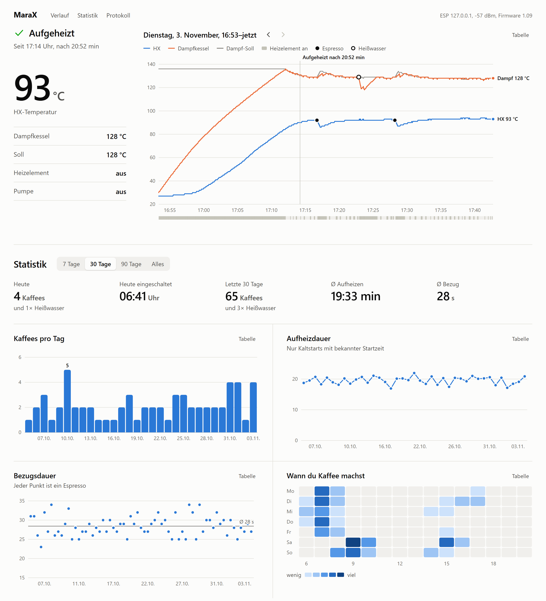
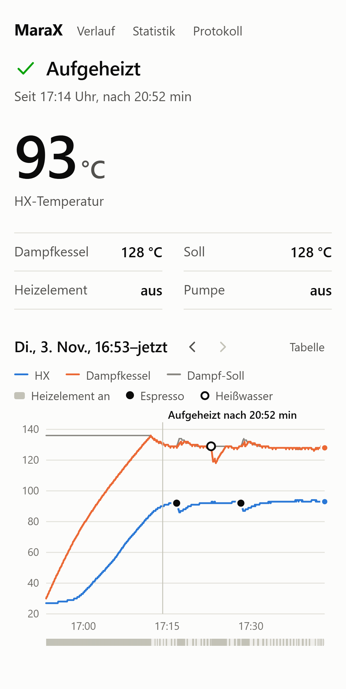

# marax_timer with WiFi, Windows tray and statistics

An extended version of [alexrus/marax_timer](https://github.com/alexrus/marax_timer). The ESP8266 still shows the shot timer on its OLED, and it also sends the machine's status over WiFi to a Windows PC.

<picture>
  <source media="(prefers-color-scheme: dark)" srcset="resources/dashboard-dark.png">
  
</picture>

- **Tray icon** with the heat exchanger temperature, colored by state: heating up, ready, pump running, water tank.
- **Statistics in the browser** at `http://localhost:8420`, also from a phone in the home network: the temperature curve of every session, espressos per day, heat-up time, shot time and the hours you make coffee.
- **Espresso or hot water:** the Mara X V2 reports when the brew group is in use, so hot water drawn from the steam boiler doesn't count as coffee.
- CSV export for Excel. No cloud, everything stays on your PC.

<picture>
  <source media="(prefers-color-scheme: dark)" srcset="resources/dashboard-phone-dark.png">
  
</picture>

The screenshots show made-up sample data. The page follows the light or dark mode of the device.

Tested with a Lelit Mara X V2 (PL62X, firmware 1.09) and a NodeMCU with a CH340 USB chip. The setup guide, the tray app and the web page are in German: [ANLEITUNG.md](ANLEITUNG.md).

## Original project

***This repository is a rewrite of [espresso_timer](https://github.com/alexrus/espresso_timer) that has better documentation and is easier to use.***

This project was designed to be used with a Lelit MaraX espresso machine (like the Lelit Mara PL62X), but it works (only the timer functionality) with any espresso machine that has a vibration pump.

## Hardware

The following hardware is needed:

- NodeMCU (ESP8266)
    - Tested with a NodeMCU V2 CP2102 board
- 0.96" OLED display
    - Tested with a 4-pin version
- Reed sensor
    - Normally closed and normally opened works
- Wires
- 3D printed case ([https://www.thingiverse.com/thing:2937731](https://www.thingiverse.com/thing:2937731))

### Hardware Connections

Connect the **OLED display** like this:

Remember that different display versions have different orders of VCC, GND, and data pins.

The **reed switch** goes to ground and D7.

The reed switch will be glued onto the machine's vibration pump like this:

If you have a Lelit MaraX machine, open the underside of the machine and you will see a 6-pin connector.

Connect pin 3 of the machine (RX) to pin D6 (TX) of NodeMCU

Connect pin 4 of the machine (TX) to pin D5 (RX) of NodeMCU

In case this does not work, change the pins connection (pin 3 to D5 & pin 4 to D6)

## Software

In order to make NodeMCU work with Arduino IDE, follow these instructions: [https://www.instructables.com/id/Quick-Start-to-Nodemcu-ESP8266-on-Arduino-IDE/](https://www.instructables.com/id/Quick-Start-to-Nodemcu-ESP8266-on-Arduino-IDE/)

### Operation

When the pump will start, the timer on the screen will also start counting.

When the pump is stopped, the time will remain printed on the screen (if more than 15 seconds have passed) until the next time the pump is activated.

The time is not recorded unless 15 seconds have passed because the MaraX machine starts the pump by itself from time to time to fill the boiler with water.

The display should go to sleep after 1 hour and will wake up when the pump is started.

If the timer immediately starts, even when the machine is off, a wrong reed sensor is used. To solve it, replace the reed sensor with another type (normally opened / normally closed) or change the `reedOpenSensor` to `true` in the `timer.ino` file.

### UI

### Windows taskbar

The ESP can send the machine's status over WiFi to a Windows tray icon, which also collects statistics and shows them on a local web page, see [ANLEITUNG.md](ANLEITUNG.md) (German). Set `WIFI_SSID` in `timer/secrets.h` to enable it, without it WiFi stays off.

### Dependencies

This project uses the following dependencies:
* [https://github.com/adafruit/Adafruit_SSD1306](https://github.com/adafruit/Adafruit_SSD1306)
* [https://github.com/adafruit/Adafruit_BusIO](https://github.com/adafruit/Adafruit_BusIO)
* [https://github.com/adafruit/Adafruit-GFX-Library](https://github.com/adafruit/Adafruit-GFX-Library)
* [https://github.com/JChristensen/Timer](https://github.com/JChristensen/Timer)

### More information

More information about the project and progress can be found [here](https://www.home-barista.com/espresso-machines/lelit-marax-t61215-350.html#p723763).